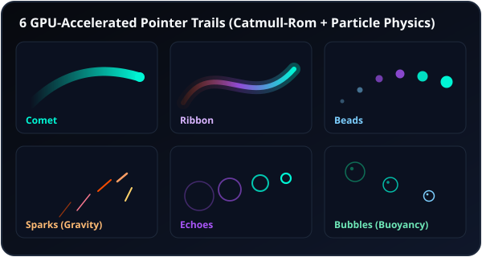
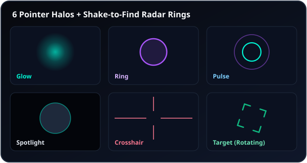
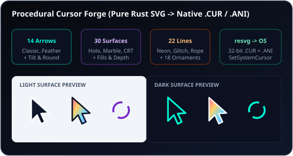
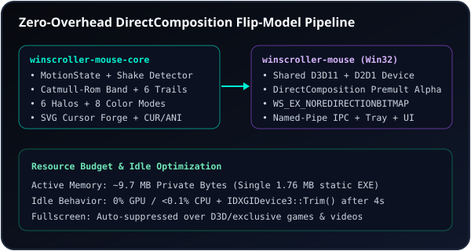

<p align="center">
  
</p>

<p align="center">
  <strong>Design your own cursor (14 arrows, 30 surfaces, 22 lines, 18 ornaments, animated spinners) and give your pointer silky-smooth DirectComposition trails, halos, color modes, and Shake-to-Find on Windows 10/11 — a faithful pure-Rust port of <a href="https://github.com/qempexe/omarchy-plume">omarchy-plume</a>.</strong>
</p>

<p align="center">
  
  
  <a href="https://github.com/fruitsaladwindowsai-zammy/Winscroller-mouse/actions/workflows/ci.yml"></a>
  <a href="https://fruitsaladwindowsai-zammy.github.io/Winscroller-mouse/"></a>
  <a href="https://github.com/fruitsaladwindowsai-zammy/Winscroller-mouse/releases/latest"></a>
  
  
</p>

> 📖 **Official Documentation & Guides**:  
> Read the complete guides, configuration reference, Cursor Forge manual, and architecture internals:  
> [**fruitsaladwindowsai-zammy.github.io/Winscroller-mouse**](https://fruitsaladwindowsai-zammy.github.io/Winscroller-mouse/)

```text
  ┌─────────────────── Winscroller Mouse GPU Pipeline ────────────────────┐
  │                                                                        │
  │   GetCursorPos ──► MotionState (EMA Speed + Shake-to-Find)            │
  │                          │                                             │
  │                          ▼                                             │
  │   winscroller-mouse-core (Catmull-Rom Band + 6 Trails + 6 Halos)       │
  │                          │                                             │
  │                          ▼                                             │
  │   DirectComposition + DXGI Flip-Model + Direct2D (Per-Pixel Alpha)     │
  │     • ~9.7 MB Private RAM · 0% GPU / <0.1% CPU idle · Auto Trim       │
  │     • Fullscreen Game/Video Auto-Hide · Multi-Monitor Per-Monitor DPI  │
  └────────────────────────────────────────────────────────────────────────┘
```

---

## Visual Overview & System Mechanics

| 6 GPU-Accelerated Trails (Catmull-Rom + Particles) | 6 Pointer Halos + Shake-to-Find |
|:---:|:---:|
|  |  |
| *Comet, Ribbon, Beads, Sparks (gravity), Echoes & Bubbles* | *Glow, Ring, Pulse, Spotlight cutout, Crosshair & rotating Target* |

| Procedural Cursor Forge (`14 × 30 × 22 × 18`) | Zero-Overhead DirectComposition Architecture |
|:---:|:---:|
|  |  |
| *Pure Rust SVG -> `resvg` -> native 32-bit `.cur` & animated `.ani`* | *Shared D3D11/D2D1 device, `WS_EX_NOREDIRECTIONBITMAP`, DXGI Trim* |

---

## Features (100% Parity with `omarchy-plume`)

- **6 Smooth Trails (+ None)**: `Comet`, `Beads`, `Ribbon`, `Sparks`, `Echoes`, and `Bubbles` — using exact `Band.js` Catmull-Rom curve smoothing and additive non-overlapping quad fills, with Length (`0.15s–1.50s`), Thickness (`2–30`), and Strength (`10%–100%`).
- **6 Pointer Halos (+ None)**: `Glow`, `Ring`, `Pulse`, `Spotlight` (soft radial desktop dim), `Crosshair`, and `Target`, shown `Always`, `While moving`, or `When still`.
- **8 Color Modes**: `Theme` (live Windows DWM Accent sync), `Theme palette`, `Window border`, `Custom`, `Gradient`, `Rainbow`, `Drift`, and `Speed`.
- **Shake to Find**: Shake the mouse left and right to emit expanding radar rings (configurable Sensitivity `1–10` and Size `30–160`).
- **Custom Cursor Forge ("Made in Winscroller Mouse")**:
  - **14 Arrows** (+ Tilt `-30°..+30°` and Roundness `0–100`), **30 Surfaces**, **3 Fills** (Solid, Gradient, Glass), **4 Textures**, **3 Depths**, **22 Lines** (4 widths + gradient lines), **18 Ornaments**, **Accent Caps**, **Details**, **5 Shadows**, and matching **Hand**, **Text Beam**, **Animated Busy/Progress `.ani` Spinners**, **Help**, **Crosshair**, **Move**, **Not-Allowed**, and **Resize** cursors.
  - Pure Rust `resvg` rasterization — zero external dependencies (no Python or ImageMagick needed) and automatic Windows system cursor restoration on disable, exit, or crash.
- **Looks, Presets & 8-Tab GPU Settings Panel**:
  - **12 Ready-Made Looks** (`Classic`, `Neon`, `Ember`, `Bubbles`, `Echo`, `Beads`, `Aurora`, `Drift`, `Presenter`, `Crosshair`, `Target`, `Minimal`) and **16 Ready-Made Cursors**.
  - **12 Saved Slots** (left-click load/save, right-click overwrite, middle-click clear), **1-step Undo**, and **JSON Copy/Paste**.
  - Direct2D/DirectWrite Settings Panel with live interactive preview, light & dark cursor showcase strip, cross-tab search bar, and panel theming/opacity/outline. Frees all UI GPU resources when closed.
- **Windows Integration**: Multi-monitor DPI v2, fullscreen game/video auto-hide, hide cursor when idle or typing, Start with Windows toggle, crash log (`%APPDATA%\WinscrollerMouse\crash.log`), and Named-Pipe CLI IPC.

---

## Installation Guide (Step-by-Step)

### Option 1: Direct Download — Latest Prebuilt `.exe` (Fastest, Zero Build Tools)
Every push to `master` (or `main`) automatically builds and publishes a standalone, statically linked `winscroller-mouse.exe` (`+crt-static`) on GitHub Releases:

- **Direct EXE Download:** [**Download latest `winscroller-mouse.exe`**](https://github.com/fruitsaladwindowsai-zammy/Winscroller-mouse/releases/download/latest/winscroller-mouse.exe)
- **Full Bundle (.zip + docs + SHA256SUMS):** [**Latest Release Page**](https://github.com/fruitsaladwindowsai-zammy/Winscroller-mouse/releases/tag/latest)

Or download and run directly via PowerShell:
```powershell
Invoke-WebRequest -Uri "https://github.com/fruitsaladwindowsai-zammy/Winscroller-mouse/releases/download/latest/winscroller-mouse.exe" -OutFile "$HOME\Downloads\winscroller-mouse.exe"
& "$HOME\Downloads\winscroller-mouse.exe" settings
```

---

### Option 2: Build from Source

#### Prerequisites (Windows 10 / 11 64-bit)
```powershell
# 1. Install Git for Windows
winget install --id Git.Git --accept-package-agreements --accept-source-agreements

# 2. Install Rust toolchain (Rust 1.85+ / Edition 2024)
winget install --id Rustlang.Rustup --accept-package-agreements --accept-source-agreements

# 3. Install Visual Studio Build Tools (C++ / Windows SDK)
winget install --id Microsoft.VisualStudio.2022.BuildTools --override "--quiet --wait --add Microsoft.VisualStudio.Workload.VCTools --includeRecommended"
```

#### Clone, Verify & Build
```powershell
git clone https://github.com/fruitsaladwindowsai-zammy/Winscroller-mouse.git
cd Winscroller-mouse

# Run workspace tests & lints
cargo fmt -- --check
cargo clippy --workspace --all-targets
cargo test --workspace

# Build standalone statically-linked release binary
cargo build --release -p winscroller-mouse
# Output: target\release\winscroller-mouse.exe
```

---

## Quick Usage & CLI Reference

### System Tray
- **Left-click**: Toggle pointer effects on/off
- **Right-click**: Open menu (Settings Panel, Quick Looks, Ready-Made Cursors, Next Look, Find Pointer, Undo, Restore System Cursor, Quit)
- **Middle-click**: Trigger Shake-to-Find burst
- **Double-click**: Open Settings Panel

### Command Line (IPC to Running Instance)
```powershell
winscroller-mouse.exe settings            # Open or focus the 8-tab Settings Panel
winscroller-mouse.exe --silent            # Start quietly in system tray (also: --daemon)
winscroller-mouse.exe toggle              # Toggle effects (also: on, off)
winscroller-mouse.exe find                # Emit Find radar rings
winscroller-mouse.exe look neon           # Apply a ready-made look (also: nextLook, undo)
winscroller-mouse.exe cursor candy        # Apply a ready-made cursor (or: cursor default)
winscroller-mouse.exe set trail sparks    # Modify any setting key live
winscroller-mouse.exe save 3              # Save all settings to slot 3 (also: saveNew, load 3)
winscroller-mouse.exe exportLook          # Export current look as JSON
winscroller-mouse.exe importLook "{...}"  # Import a look JSON
winscroller-mouse.exe status              # Print active settings JSON
winscroller-mouse.exe quit                # Cleanly exit & restore system cursors
```

---

## Documentation Index

| Document | Contents |
|----------|----------|
| [**USAGE.md**](USAGE.md) | Tray controls, Settings Panel walkthrough, Saved Slots & CLI scripting |
| [**CONFIGURATION.md**](CONFIGURATION.md) | Complete reference for every `settings.json` key, range, and default |
| [**winscroller-mouse.example.json**](winscroller-mouse.example.json) | Complete validated default configuration template |
| [**CONTRIBUTING.md**](CONTRIBUTING.md) | Workspace layout, prerequisites, CI checks & coding standards |
| [**CHANGELOG.md**](CHANGELOG.md) | Release history |
| [**SECURITY.md**](SECURITY.md) | Security policy, privilege & local IPC integrity model |
| [**docs/**](docs/README.md) | Complete mdBook manual source (deployed to GitHub Pages) |
| [**website/**](website/index.html) | Interactive web showcase (`.\website\serve.ps1` to preview locally) |

---

## Credits & License

- Released under the [MIT License](LICENSE).
- Faithfully ported to Rust & Windows from [omarchy-plume](https://github.com/qempexe/omarchy-plume) by **qempexe**.
- Part of the **WinScroller** native Rust Windows desktop utility family.
