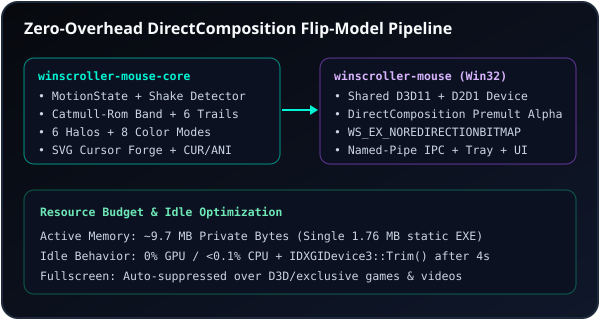

# Architecture & GPU Pipeline

## Two-Crate Workspace
- **`winscroller-mouse-core`**: Pure, OS-agnostic Rust library containing motion tracking, shake detection, Catmull-Rom `Band` smoothing, all 6 trails, all 6 halos, all 8 color modes, settings schema, SVG Cursor Forge, and CUR/ANI/ICO encoders.
- **`winscroller-mouse`**: Thin native Windows daemon hosting the DirectComposition/Direct2D renderer, Win32 system tray, DirectWrite 8-tab Settings Panel, Named-Pipe IPC server, DWM theme watcher, fullscreen detector, and Windows cursor applier.

## Why DirectComposition + Flip-Model DXGI?
- **True Per-Pixel Alpha**: `CreateSwapChainForComposition` with `DXGI_ALPHA_MODE_PREMULTIPLIED` and `DXGI_SWAP_EFFECT_FLIP_SEQUENTIAL` composites cleanly through DWM over every application window.
- **No GDI Redirection Overhead**: `WS_EX_NOREDIRECTIONBITMAP` eliminates the duplicate desktop redirection bitmap (saving 16–32 MB per 4K display).
- **Exact Blending**: Uses `D2D1_PRIMITIVE_BLEND_ADD` for seamless Catmull-Rom trail quads and an inverted radial gradient cutout for Spotlight.
- **Zero-Idle Power & Memory**: When pointer trails finish and no continuous halo is active, overlays clear once, the main loop sleeps at low power (`< 0.1%` CPU), and `IDXGIDevice3::Trim()` releases unused GPU staging memory after 4 seconds.
