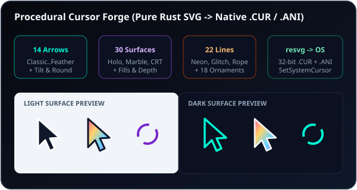

# Custom Cursor Forge

Switch **Cursor Mode** to **Made in Winscroller Mouse** in the **Cursor** tab to generate a complete custom Windows cursor set on the fly.

## Composable Parts
- **14 Arrows**: Classic, Slim, Chunky, Wedge, Dart, Kite, Needle, Teardrop, Leaf, Bullet, Crest, Chevron, Feather, Dot (+ Tilt `-30°..+30°` and Roundness `0–100`).
- **30 Surfaces**: Solid, Faint, Two-tone, Split, Frost, Bevel, Keycap, Metal, Carbon, Old screen (CRT), Candy, Halftone, Hologram, Comet, Damask, Velvet, Marble, Ledge, Band, Underglow, Spiderweb, Wood, Terrazzo, Crackle, Contours, Nebula, Leather, Stained glass, Only a shadow, Clear.
- **Fills, Textures & Depth**: Solid, Gradient (6 target modes × 4 directions), Glass; Stripes/Dots/Grid; Flat/Raised/Sunken; Opacity (`30–100%`) & Accent tint.
- **22 Lines**: None, Solid, Double, Triple, Glow ring, Neon tube, Dashed, Dotted, Dash and dot, Stitched, Inset line, Mat, Rail, Wavy, Sawtooth, Rope, Chain, Beads, Ladder, Sketched, Gilded frame, Glitch — with 4 line widths & gradient fades.
- **18 Ornaments + Caps & Details**: Studs, Rivets, Pearls, Crosses, Stars, Brackets, Rosettes, Diamonds, Fleurons, Filigree, Flourish, Scrolls, Chevrons, Fans, Deco, Crown, Laurels, Accent cap (`tip`/`tail`/`both`), Detail (`tip`/`spine`/`spark`).
- **5 Shadows**: None, Soft, Strong, Hard, Long (dark or accent glow, below or all around).

## Native Windows `.cur` & `.ani` Output
Every cursor glyph (`arrow`, `hand`, `ibeam`, `cross`, `help`, `no`, `sizeall`, `sizens`, `sizewe`, `sizenesw`, `sizenwse`, `up`, plus animated 12-frame `wait.ani` and `appstarting.ani`) is rendered in pure Rust via `resvg` into 32-bit PNG-in-CUR and RIFF ACON `.ani` binaries under `%LOCALAPPDATA%\WinscrollerMouse\cursors\` and applied live via `SetSystemCursor`.
