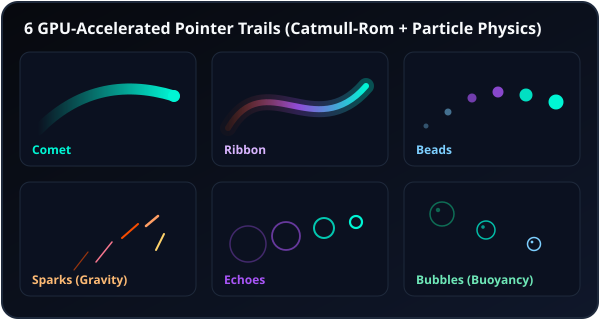
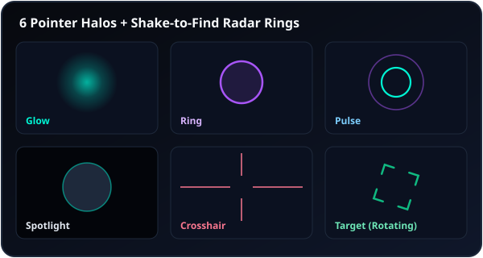

# Trails, Halos & Color Modes

## 6 Pointer Trails

| Trail | Mechanics |
|-------|-----------|
| **Comet** | Catmull-Rom smoothed tapered band with additive non-overlapping quads and half-circle head cap. |
| **Ribbon** | Two-pass glowing smoothed band (wide translucent aura + crisp inner ribbon). |
| **Beads** | Evenly spaced dots along the path, shrinking and fading toward the tail. |
| **Sparks** | Dynamic velocity particles launched along motion, falling under `160 px/s²` gravity. |
| **Echoes** | Expanding concentric rings dropped along the path as they fade. |
| **Bubbles** | Buoyant rings rising at `28 px/s` with sinusoidal sway and specular highlight dots. |

## 6 Pointer Halos

- **Glow**: Soft multi-stop radial illumination.
- **Ring**: Crisp circle with subtle translucent interior.
- **Pulse**: Breathing ring emitting periodic expanding waves.
- **Spotlight**: Dims the monitor outside a soft radial cutout around the pointer (ideal for presentations with `Show: When still`).
- **Crosshair**: Full-screen gradient alignment guides through the pointer.
- **Target**: Slowly rotating corner reticle brackets.

## 8 Color Modes

- **Theme**: Syncs live to your Windows DWM Accent Color (`HKCU\Software\Microsoft\Windows\DWM\AccentColor`).
- **Theme palette**: Walks smoothly across an 8-color harmonious palette derived from your Windows theme.
- **Window border**: Blends across your active window border gradient.
- **Custom** & **Gradient**: One or two custom `#RRGGBB` colors.
- **Rainbow**, **Drift**, and **Speed** (cool blue when moving slowly, hot red when flying at high speed).
