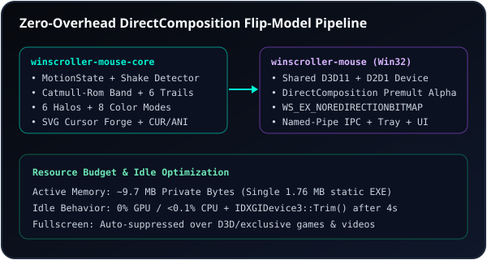

# Architecture and Internals

- **`crates/winscroller-mouse-core`**: Pure OS-agnostic Rust library (motion physics, Catmull-Rom Band smoothing, 6 trails, 6 halos, 8 color modes, settings schema, SVG Cursor Forge, CUR/ANI/ICO binary encoders).
- **`crates/winscroller-mouse`**: Native Windows 10/11 daemon using a shared Direct3D11 + Direct2D1 + DirectComposition device across monitors, `WS_EX_NOREDIRECTIONBITMAP` click-through overlays, DirectWrite 8-tab Settings UI, Named-Pipe IPC, and `IDXGIDevice3::Trim()` idle memory management.
