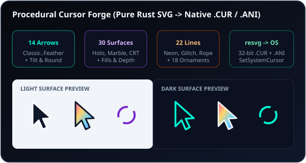

# Custom Cursor Forge

Enable **Made in Winscroller Mouse** in the **Cursor** tab to compose a custom Windows cursor set:
- **14 Arrows** (+ Tilt & Round corners), **30 Surfaces**, **3 Fills** (Solid, Gradient, Glass), **4 Textures**, **3 Depths**, **22 Lines** (4 widths + gradient lines), **18 Ornaments**, **Accent Caps**, **Details**, and **5 Shadows**.
- Matching **Hand**, **Beam**, **Animated Busy/Progress `.ani`**, **Help**, **Crosshair**, **Move**, **Not-Allowed**, and **Resize** cursors.
- Pure Rust `resvg` rasterization into `%LOCALAPPDATA%\WinscrollerMouse\cursors\`, applied live via `SetSystemCursor` and automatically restored via `SPI_SETCURSORS`.
