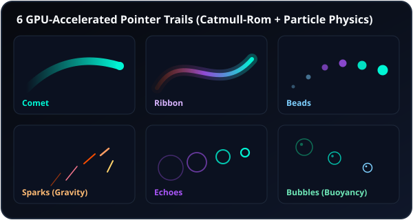
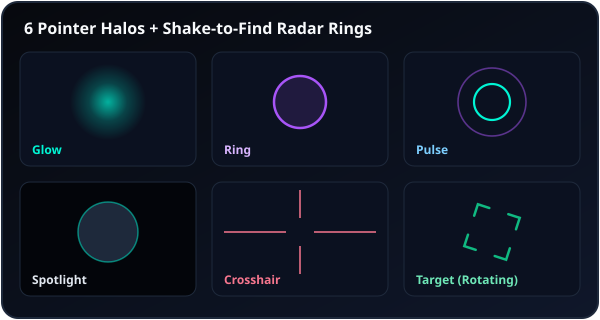

# Trails, Halos & Color Modes

## Trails (6 + None)
- **Comet**, **Ribbon** (exact Catmull-Rom smooth additive quads), **Beads**, **Sparks** (gravity particle physics), **Echoes**, and **Bubbles** (rising buoyant rings).

## Halos (6 + None)
- **Glow**, **Ring**, **Pulse**, **Spotlight**, **Crosshair**, and **Target** — visible `Always`, `While moving`, or `When still`.

## Color Modes (8)
- `Theme` (live Windows DWM accent), `Theme palette`, `Window border`, `Custom`, `Gradient`, `Rainbow`, `Drift`, and `Speed`.
